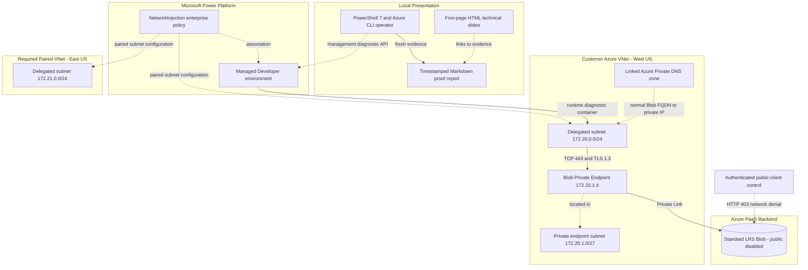
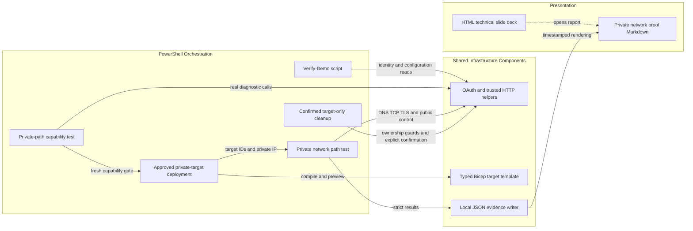

# Architecture Diagram

This reference implementation combines an HTML slide deck and Markdown reports with
PowerShell/Bicep orchestration. The diagrams separate
configuration relationships from the actual West US private diagnostic path.

## Application Architecture

<!-- mermaid-checked: no \n, no em-dash/en-dash, no {} in labels, subgraphs are id["label"], arrows are -->|"label"|, all subgraphs closed by end, ids unique -->

### Technology Stack Summary

| Layer | Technology | Version | Purpose |
| --- | --- | --- | --- |
| Presentation | Self-contained HTML, CSS and JavaScript | Browser standards | Five-page technical slides with navigation and printing |
| Documentation and reports | Markdown and Mermaid | GitHub-compatible | Timestamped protocol evidence and architecture diagrams |
| Orchestration | PowerShell | 7 | Actual probes, strict assertions, JSON/Markdown evidence |
| Authentication | Azure CLI and Microsoft Entra OAuth | Installed CLI | Explicit tenant/account/subscription; no project credentials |
| Infrastructure | Bicep | Validated with 0.48.1 | Incremental, approved Azure deployments |
| Runtime | Power Platform managed diagnostics | Managed service | Probes originate in delegated subnet |
| Network/backend | Azure VNet, Private Link, Private DNS, StorageV2 | Managed service | Private target with public access disabled |

### Data Storage & External Services

The empty Standard_LRS Blob account is the protocol-test target, not a store
of business payloads. Microsoft management APIs provide role/configuration
checks and official Power Platform DNS/TCP/TLS diagnostics. Raw evidence is
stored locally as JSON; the generated Markdown report exposes no access tokens.

### Key Architectural Decisions

- Solid private-path edges represent observed protocol communication; dotted
  edges are control-plane, DNS, placement, or denied-public relationships.
- West US and East US satisfy the United States region-pair requirement; only
  the West US target path was tested. East US failover is not claimed.
- Delegated and Private Endpoint subnets are separate. Network access does
  not replace backend data authorization or managed-environment licensing.

## Component Relationships

<!-- mermaid-checked: no \n, no em-dash/en-dash, no {} in labels, subgraphs are id["label"], arrows are -->|"label"|, all subgraphs closed by end, ids unique -->

### Component Inventory

| Component | Layer | Type | Responsibility |
| --- | --- | --- | --- |
| `customer-demo-slides.html` | Presentation | HTML/JavaScript | Five-page technical slides with navigation and printing |
| `private-network-proof.md` | Reports | Generated Markdown | Actual protocol evidence and limits |
| `Demo.Reports.ps1` | Infrastructure | Shared report renderer | Escaped Markdown templates with explicit status and missing-value errors |
| `Verify-Demo.ps1` | Orchestration | PowerShell script | Verify configuration, association and baseline preservation |
| `Test-PrivatePathCapability.ps1` | Orchestration | PowerShell script | Warm diagnostic containers and verify actual source subnet |
| `Test-PrivateNetworkPath.ps1` | Orchestration | PowerShell script | Assert exact private target, source IPs, TLS and public rejection |
| `Deploy-PrivatePathTarget.ps1` | Orchestration | PowerShell script | Risk-approved, add-only deployment with capability gate |
| `Remove-PrivatePathTarget.ps1` | Orchestration | PowerShell script | Preview or explicitly confirm target-only deletion |
| `Demo.Common.ps1` | Infrastructure | Shared helpers | Verified OAuth identity, trusted URLs, explicit bounded retries |
| `private-path.bicep` | Infrastructure | IaC | Reference existing VNet; add private-only test target |

The facts are sourced from `demo.config.json`, deployment state and
`private-path-verification.json`. No business application, payload read/write,
packet capture, or East US disaster-recovery test is inferred.
