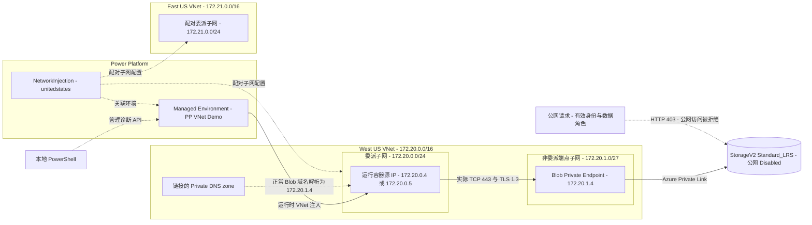

# Power Platform VNet 私网集成

基于官方配置流程的低成本参考实现，涵盖出站网络架构、IP 容量、权限分层与实际私网协议验证。

## 1. 概览

参考路径为：

```text
Power Platform 委派子网 → Private Endpoint → 禁止公网访问的 Blob 服务
```

| 主题 | 内容 |
| --- | --- |
| 架构与官方流程 | 区域配对、专用子网、NetworkInjection 企业策略及环境关联 |
| 规划与最小权限 | IP 容量、网络隔离、DNS、配置身份与运行身份授权 |
| 可重复的协议验证 | 私网 DNS、TCP、TLS 1.3 与带身份的公网拒绝对照 |

**验证边界：**参考部署已验证 West US 的实际私网协议路径，未覆盖业务对象读写、
East US 故障切换或产品许可验收。VNet 出站集成不表示整个 Power Platform 或 Dataverse
被部署到客户 VNet。

## 2. 架构与官方配置流程

### 参考部署拓扑

<!-- mermaid-checked: no \n, no em-dash/en-dash, no {} in labels, subgraphs are id["label"], arrows are -->|"label"|, all subgraphs closed by end, ids unique -->


实线表示参考部署验证的私网协议路径；虚线表示配置、解析或管理关系，
以及单独执行的公网拒绝对照。实际 DNS、TCP 和 TLS 探针运行在 Power Platform
委派子网的容器内，本地 PowerShell 仅发起管理诊断 API。

| 组件 | 配置与职责 |
| --- | --- |
| Power Platform 环境 | 独立托管 Developer 环境，实际区域 `westus` |
| 企业策略 | `NetworkInjection`，location 为 Power Platform geography `unitedstates` |
| 委派子网 | 专用于 `Microsoft.PowerPlatform/enterprisePolicies`，分配运行容器的源 IP |
| 目标端点子网 | 非委派子网，承载 PE NIC；NSG 允许来自委派 `/24` 的 TCP 443 |
| Private DNS | 正常 Blob FQDN 在关联 VNet 内解析为 PE IP `172.20.1.4` |
| Storage Blob | Azure 托管服务，通过 Private Link 接入，不是将服务本体放入端点子网 |
| East US 配对网络 | 满足美国 geography 的配对配置要求，未执行后端可达性或灾备验收 |

Private Endpoint 和 Private DNS 是参考实现的私有目标验证资源，
并非所有 Power Platform VNet 场景的固定必选资源。

### 官方配置顺序

1. **检查前提与实际区域。** 环境需启用 Managed Environments，具备相应角色和许可；
   使用 `Get-EnvironmentRegion` 确认实际 region 及配对要求。
2. **准备 Azure 网络。** 注册 `Microsoft.Network` 和 `Microsoft.PowerPlatform`；
   创建配对 VNet 和专用子网，将子网委派给 `Microsoft.PowerPlatform/enterprisePolicies`。
3. **创建企业策略。** 使用 `NetworkInjection`，location 为 Power Platform geography，
   并引用两个区域的 VNet 和子网。
4. **保证关联者可读取策略。** 关联身份需具备 Power Platform 管理权限，
   并可读取 Enterprise Policy；创建人与关联人不同时，可补策略范围的 Azure Reader。
5. **关联环境并确认完成。** 使用 `Enable-SubnetInjection` 或管理中心，
   检查环境 History 或实际异步操作状态为 `Succeeded`。
6. **独立验证实际路径。** 从环境内执行 DNS、TCP、TLS 及公网拒绝对照。
   策略关联成功本身不证明私网协议或业务访问成功。

### 官方文档 URL

- 配置流程：<https://learn.microsoft.com/en-us/power-platform/admin/vnet-support-setup-configure?pivots=powershell>
- 区域、IP 规划与限制：<https://learn.microsoft.com/en-us/power-platform/admin/vnet-support-overview>
- 网络诊断：<https://learn.microsoft.com/en-us/troubleshoot/power-platform/administration/virtual-network>

## 3. 网段规划：IP 用途与容量计算依据

委派 IP 分配给运行容器，而非每个用户、流程或请求。
VNet 地址池、Power Platform 委派子网与 Private Endpoint 子网分别定容。

| 参考地址范围 | IP 分配对象与用途 | 容量规划依据 |
| --- | --- | --- |
| VNet：`172.20.0.0/16`、`172.21.0.0/16` | 容纳各类子网和未来扩展；地址池大小不等于运行实例数量 | 子网总需求、未来扩展和企业 IPAM；避免与本地、VPN、未来对等网络重叠。`/16` 不是固定要求 |
| 委派子网：`172.20.0.0/24`、`172.21.0.0/24` | 执行插件或受支持连接器等请求的容器 NIC；每容器使用一个 IP，可处理多个并发请求 | 同一策略关联的各环境峰值需求之和，加伸缩和增长余量；两区均有 251 个可用 IP，不能对半分摊需求 |
| 非委派端点子网：`172.20.1.0/27` | PE NIC 的目标 IP；单个 Blob PE 使用 `172.20.1.4`，不是 Storage 服务本体 | 各 PE 实际 IP 配置数量，加 5 个 Azure 保留地址和扩展余量；不占用 Power Platform 委派子网 |

### 环境峰值需求

- **按环境数汇总。** 同一策略及子网承载的所有环境均纳入预算，
  用户数、流程数和业务数据量不能直接换算为 IP 数。
- **以官方经验值起算。** 生产每环境 **25–30 IP**，非生产每环境 **6–10 IP**。
  这些是规划参考，不是硬上限或容量保证。
- **根据峰值修正。** 调用并发和持续时间影响容器伸缩；
  结合高峰、压测和 `Get-EnvironmentUsage` 的实际占用，计入伸缩与增长空间。

### CIDR 计算

每个委派子网分别满足：

```text
可用 IP 数 = 2^(32 − 前缀长度) − 5
可用 IP 数 ≥ 各环境峰值 IP 预算之和 + 余量
```

示例：4 个生产环境 × 30 IP，加上 30 IP 余量，需要 **150 个可用 IP**。
加 Azure 保留的 5 个地址，需要至少 155 个总地址。

| CIDR | 总地址 | Azure 保留 | 可用地址 | 是否满足 150 IP 需求 |
| --- | ---: | ---: | ---: | --- |
| `/25` | 128 | 5 | 123 | 否 |
| `/24` | 256 | 5 | 251 | 是 |

30 IP 余量为示例参数，不是官方固定比例。参考部署的委派 `/24` 和端点 `/27`
均含有容量余量，**不是所有场景的最低网段要求**；端点 `/27` 有 27 个可用 IP。

### 隔离与变更要求

- 配对委派子网应有相同的可用 IP 数，各自满足完整预算。
- 同一委派子网不得同时用于多个企业策略；同一策略关联多个环境时需合并容量。
- 启用后修改 CIDR 或 VNet DNS 需遵循官方变更流程，评估停用、支持和重新启用窗口，
  而不是直接在线调整。
- 两区后端可达性、DNS 与灾备需要分别验证；区域配对配置不等于故障切换验收通过。

关键区分：**运行容器的源 IP 不等于私有端点的目标 IP；容量基于峰值运行实例，
不是按用户一一分配。**

官方依据：<https://learn.microsoft.com/en-us/power-platform/admin/vnet-support-overview#estimating-subnet-size-for-power-platform-environments>

## 4. 权限分层：配置、运行与数据授权

网络路径、Azure 管理面、Entra 管理角色、环境/Dataverse 数据面、
后端连接身份和产品许可分别检查。

### 配置与维护

| 任务 | 授权要求与范围 |
| --- | --- |
| 创建 VNet、子网、PE、DNS | 目标 RG/VNet 的对应网络权限，例如 Network Contributor；创建 Storage 还需该资源写入权限 |
| 创建企业策略 | RG Contributor 或精简自定义角色，显式包含 `Microsoft.PowerPlatform/enterprisePolicies/read` 和 `write`；Network Contributor 不自动涵盖这些操作 |
| 订阅准备 | 注册资源提供程序、创建资源组所需的对应订阅权限 |
| 分配 Azure 数据角色 | 目标范围的 `Microsoft.Authorization/roleAssignments/write`，例如适用范围的 Owner、User Access Administrator 或 Role Based Access Control Administrator |
| 配置托管环境并关联策略 | Power Platform Administrator 和策略读取权限；不同关联人可补策略范围 Azure Reader |

参考部署使用 PIM 临时激活的 Global Administrator；生产优先采用较小的适用角色。
管理员角色本身不授予产品许可证或后端数据面权限。

### 后续工作负载使用

| 层次 | 授权与边界 |
| --- | --- |
| 制作或使用应用/流程 | 对应共享权限及环境角色；制作资源按需使用 Environment Maker，普通使用者不需要 Azure Owner 或 Global Administrator |
| Dataverse 表和数据 | 按应用、表和行授予实际安全角色；System Administrator 限于确需数据管理的身份，Environment Maker 不自动授予数据访问权 |
| 私有后端 | 连接的实际执行身份需独立数据授权；Blob 只读使用 Storage Blob Data Reader，读写按需使用 Storage Blob Data Contributor，并限制到账户/容器范围 |
| 托管环境运行许可 | 符合对应应用、云流、代理的 Premium、Dynamics 365 权益或适用计费要求；Developer Plan 不替代 Managed Environment 中的资产运行许可 |

### 管理诊断身份

本项目脚本要求活跃的 Power Platform Administrator 或 Global Administrator，
并能读取 Azure 网络、端点和存储配置。测试 Storage 上的 Blob Data Reader
用于带身份的公网拒绝对照，不是应用数据读写测试。

管理诊断身份与普通工作负载使用身份应分离。参考验证未运行业务资产。

**权限结论：**

- Azure Owner 不等于 Power Platform 管理员。
- 网络路径可达不等于数据可读。
- 管理员角色不等于 Premium 许可证。

官方依据：

- 环境/Dataverse 角色：<https://learn.microsoft.com/en-us/power-platform/admin/database-security>
- Blob 数据面 RBAC：<https://learn.microsoft.com/en-us/azure/storage/blobs/assign-azure-role-data-access>
- 托管环境许可：<https://learn.microsoft.com/en-us/power-platform/admin/managed-environment-licensing>
- Azure 网络角色：<https://learn.microsoft.com/en-us/azure/role-based-access-control/built-in-roles/networking#network-contributor>

## 5. 技术总结与后续验证

配置关联、网络路径和业务访问属于不同验收层次。
环境内实际通信、目标网络设置和公网反向对照共同构成协议路径证据。

| 层次 | 参考部署结论 |
| --- | --- |
| 已验证 | West US 来源位于委派子网；目标为实际 PE；私有 DNS、TCP、TLS 1.3、微软证书与 CRL 检查通过；带身份的公网请求被拒绝 |
| 未验证 | 连接器/插件业务对象读写、运行许可、East US 后端可达性与故障切换 |
| 生产适配 | 企业 IPAM、身份与数据授权、网络治理、成本预算及独立清理计划 |

低成本验证目标为一个 Private Endpoint 和 Private DNS，资源保留期间持续计费。
参考零售价约为 PE US$0.01/小时、DNS zone US$0.50/月，另有变量费用；
实际费用以区域、合同和当前价格为准。

- [公开脱敏证据示例](./sample-private-network-proof.html)：历史结构，不代表当前环境状态。
- [部署与验证文档](../README.md)：运行前提、复现流程、验收检查、成本和清理。
- [官方配置流程](https://learn.microsoft.com/en-us/power-platform/admin/vnet-support-setup-configure?pivots=powershell)。

公开版本不包含真实租户、订阅、账号或运行清单。本地测试生成的
`reports/private-network-proof.html` 和 `.azure/private-path-verification.json`
由运行主机保留；实际验收以新测试的时间戳及原始证据为准。
